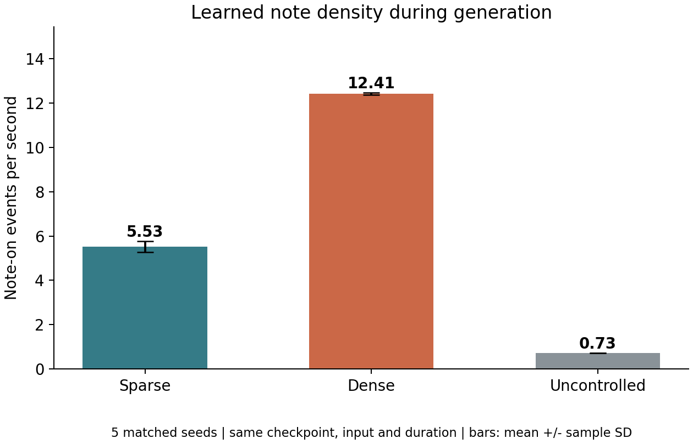
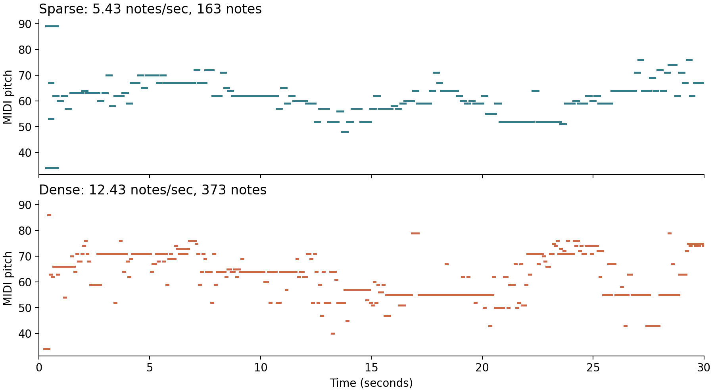

# Controllable Music Generation using Learned Note Density

## Contribution and integration

The completed four-model replication is preserved. This contribution extends one
generator: the original PyTorch encoder-decoder, using its unchanged model classes
and pretrained epoch-105 weights. A small conditional regression model learns how
to emit sparse or dense note events from performance MIDI. It predicts onset gap,
note duration and chord size during decoding, before events are written to MIDI.
The predicted event feeds the next decoder input. This is learned event control,
not random deletion, insertion or duplication of finished music.

## Experimental protocol

Use the MAESTRO v3.0.0 Chopin subset as substitute training material. Select 28
performances with a deterministic title-hash rule and preserve the official
composition-disjoint train/validation/test partitions (16/6/6 performances). Take
at most 240 seconds per performance. Manifest filenames and SHA256 hashes are in
`datasets/manifest.json`.

Measure note density as positive-velocity note-on events per second. Four-second,
non-overlapping windows receive labels using training-only 40th/60th percentiles:
sparse <= 7.25 notes/sec, dense >= 11.00 notes/sec, exclude the middle band. Merge
tracks using the MIDI tempo map; treat each pitch of a chord as a separate note-on.
Key-down duration excludes pedal sustain. Group near-simultaneous performed strikes
within 30 ms for context/chord-size features.

| Split | Performances | All windows | Sparse | Dense | Middle excluded |
| --- | ---: | ---: | ---: | ---: | ---: |
| Train | 16 | 883 | 355 | 359 | 169 |
| Validation | 6 | 323 | 193 | 77 | 53 |
| Test | 6 | 334 | 101 | 154 | 79 |

Seed 229 controls classifier initialization and generation. Five generation trials
use seeds 229-233. Both modes share the same bundled `202.mid` seed context,
epoch-105 checkpoint, controller, piano pitch range, sampling temperature and
30-second target duration. Metrics below were obtained by reopening generated files.

## Diagnostic classifier evaluation

Inputs are pitch mean, standard deviation and range; note-duration mean and standard
deviation; and mean onset chord size. Current note count, density and inter-onset gap
are excluded. Compare a majority baseline, logistic regression and a small 16/8 MLP.
Select the learned classifier by validation balanced accuracy, without using test
results to select it.

| Model | Train accuracy | Validation accuracy | Validation balanced accuracy | Test accuracy | Test balanced accuracy |
| --- | ---: | ---: | ---: | ---: | ---: |
| Majority class | 50.28% | 28.52% | 50.00% | 60.39% | 50.00% |
| Logistic regression (selected) | 91.04% | 94.81% | 95.98% | 85.49% | 86.79% |
| Small MLP | 98.60% | 95.19% | 95.07% | 88.24% | 89.41% |

Selected-model confusion matrix, rows = actual, columns = predicted:

| Actual / predicted | Sparse | Dense |
| --- | ---: | ---: |
| Sparse | 94 | 7 |
| Dense | 30 | 124 |

This classifier diagnoses whether musical features recover the automatic density
labels. It does not measure musical quality, and it is not the component that drives
generation. The classifier and generative controller have separate roles.

## Learned controller evaluation

A StandardScaler plus multi-output ridge regressor (`alpha=10`) predicts log onset
gap, log mean duration and log chord size from previous-onset pitch/duration/size
context and requested mode, with mode-context interactions. It trains on 18,419
labeled training events, validates on 4,675 and tests on 6,504. Output constraints
are training-only global 1st/99th percentiles, shared across both modes.

| Held-out test target | Conditional controller MAE | Unconditional mean MAE |
| --- | ---: | ---: |
| Onset gap, seconds | 0.07884 | 0.08392 |
| Mean note duration, seconds | 0.12137 | 0.14061 |
| Chord size, notes | 0.79698 | 0.83404 |

The learned controller improves all three held-out errors over an unconditional
mean predictor. Improvements are modest; regression accuracy alone does not establish
effective generation control, so outputs are evaluated separately.

## Generated music control

| Mode | Trials | Duration per trial | Mean notes/sec | Sample SD |
| --- | ---: | ---: | ---: | ---: |
| Sparse | 5 | 30 s | 5.5267 | 0.2443 |
| Dense | 5 | 30 s | 12.4067 | 0.0494 |

Dense exceeded sparse in **5/5 matched pairs**. The mean paired difference was
**6.88 notes/sec**, with dense about **2.24 times** sparse. All ten controlled
outputs also lie in their requested training-derived density regimes.

For the first pair (seed 229):

| Metric | Sparse | Dense |
| --- | ---: | ---: |
| Note-on events | 163 | 373 |
| Duration | 30 s | 30 s |
| Notes/sec | 5.4333 | 12.4333 |
| Unique pitches | 23 | 34 |

The full per-file values, including inter-onset gaps, are in
`outputs/density_comparison.csv`. MIDI and provenance live under
`outputs/runs/seed_229_n_5_seconds_30/`; per-step traces are generated locally and
ignored by Git. The controller-disabled reference produced
0.7333 notes/sec for this input; it is deterministic and uses a different decoding
rule, so it is a descriptive reference rather than a pure causal ablation or the
original replication's generation metric.





## Verification and limitations

Seven automated checks passed: tempo changes across tracks, velocity-zero note-off,
simultaneous-note density, equal-duration MIDI output, bounded onset grouping,
explicit invalid MIDI handling, train-only labels/piece isolation, original
encoder-decoder raw-forward equivalence, and deterministic MIDI bytes with repeated
seed plus positive density separation. Some checks cover multiple related cases.

The baseline generator is frozen. Seed conversion assumes 4/4 and zero sharps and
normalizes durations to the original 120 BPM vocabulary. Conditional log regression
smooths expressive timing. Performance-window samples within a piece are correlated.
Only one generation seed context and a small Chopin subset were evaluated. Density
is not complexity or quality, and objective density cannot establish listener
preference. Human listening and teammate approval remain before a final classroom
demonstration or merge to `main`.

## Reproduce

```text
python -m pip install -r extension/requirements-lock.txt
python -m extension.run_demo --rebuild --trials 5 --seconds 30 --seed 229 --include-uncontrolled --render-audio
python -m unittest discover -s extension/tests -v
```

Run from the repository root in a Python 3.12 virtual environment. Source data,
checkpoint and large local artifacts are ignored; tiny trained models, measured
results and plots are included. No historical paper metric is claimed to have been
exactly reproduced by this extension.

## References

Kang, D., Kim, J. Y., and Ringdahl, S. (2018).
[Generating music with Machine Learning](https://cs229.stanford.edu/proj2018/report/18.pdf), Stanford CS229.

Hawthorne, C., et al. (2019). *Enabling Factorized Piano Music Modeling and Generation
with the MAESTRO Dataset*. ICLR. [MAESTRO v3.0.0](https://magenta.tensorflow.org/datasets/maestro),
Google LLC, CC BY-NC-SA 4.0.
